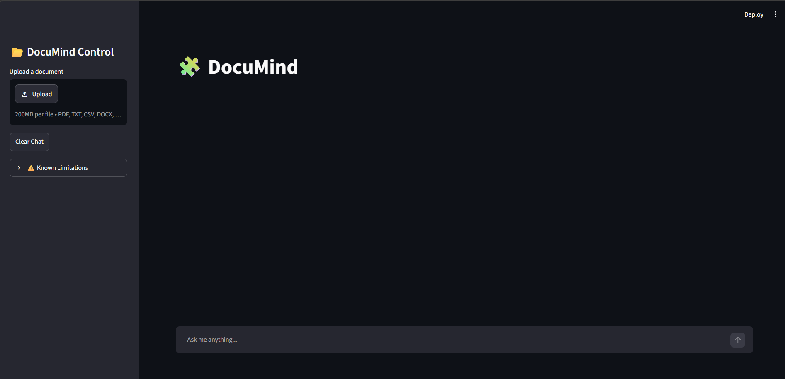
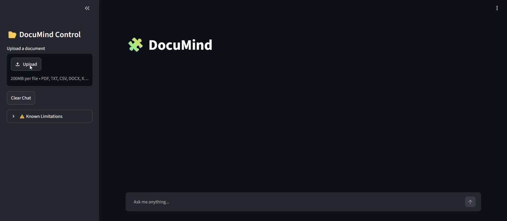
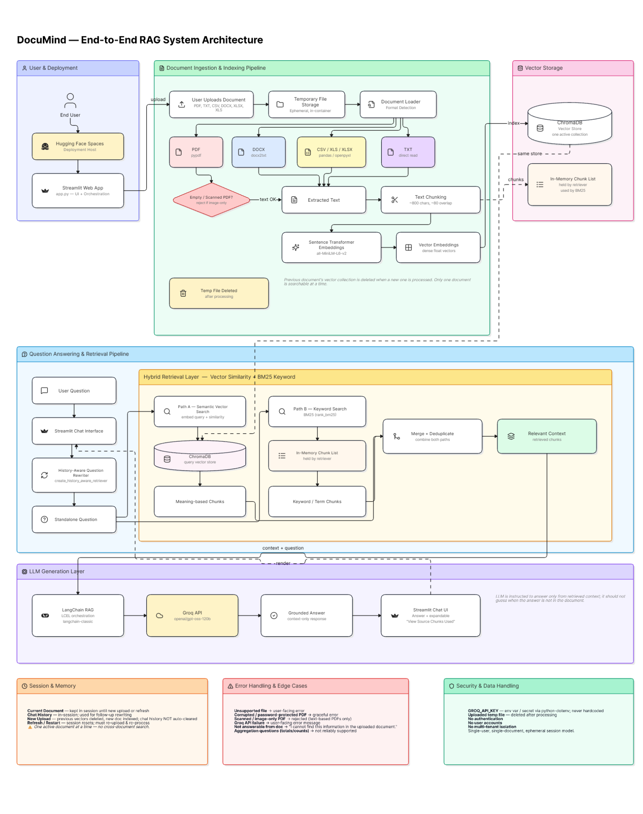
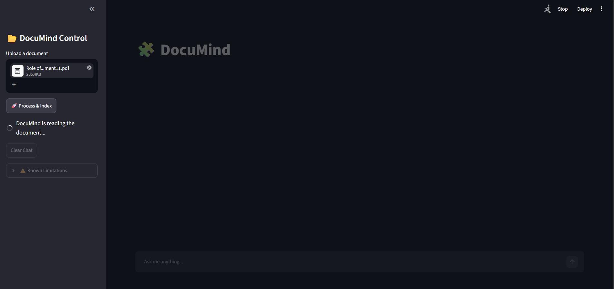
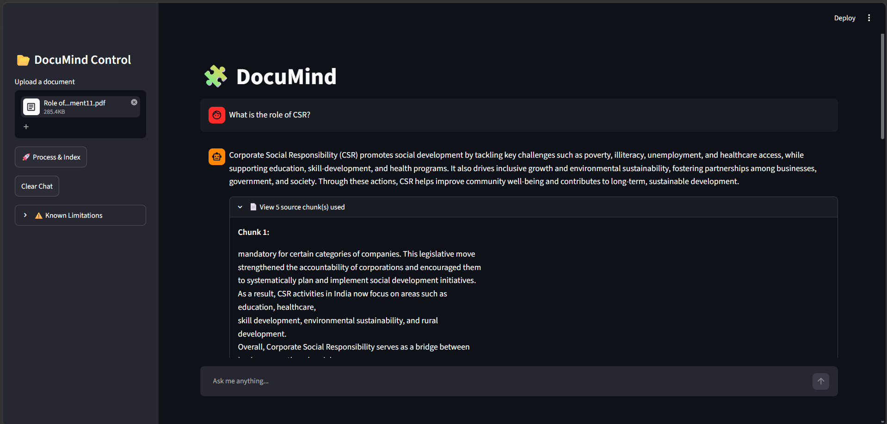
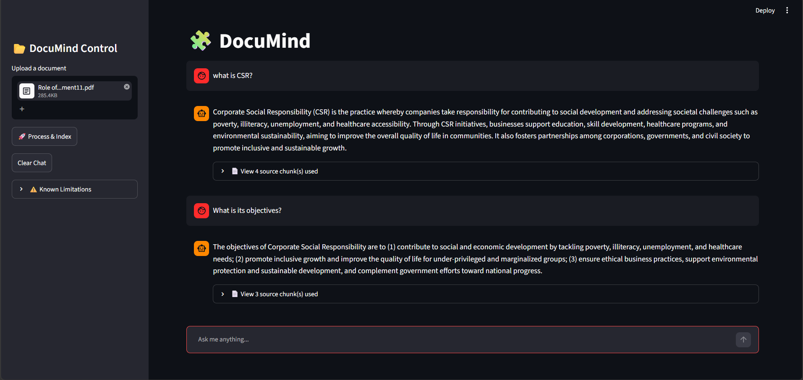
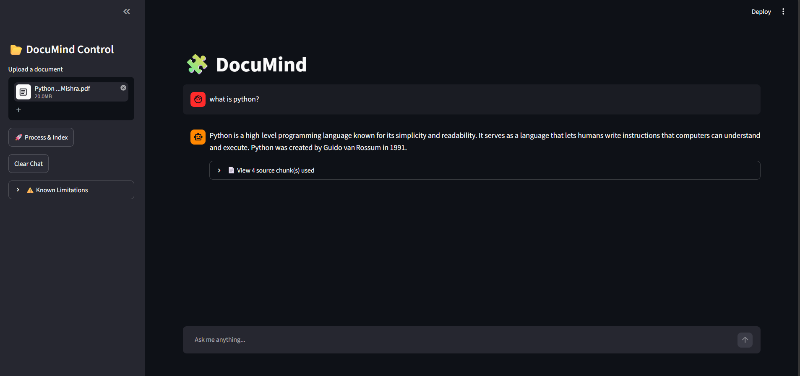
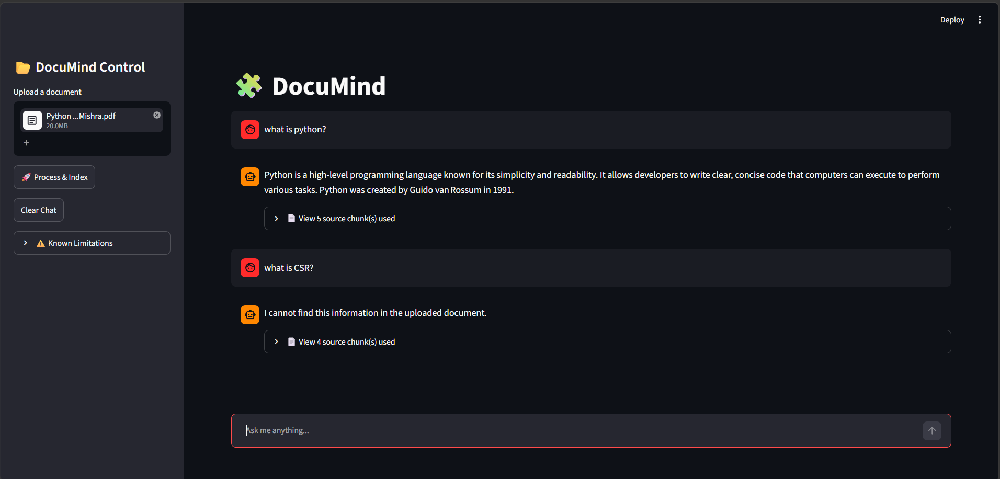
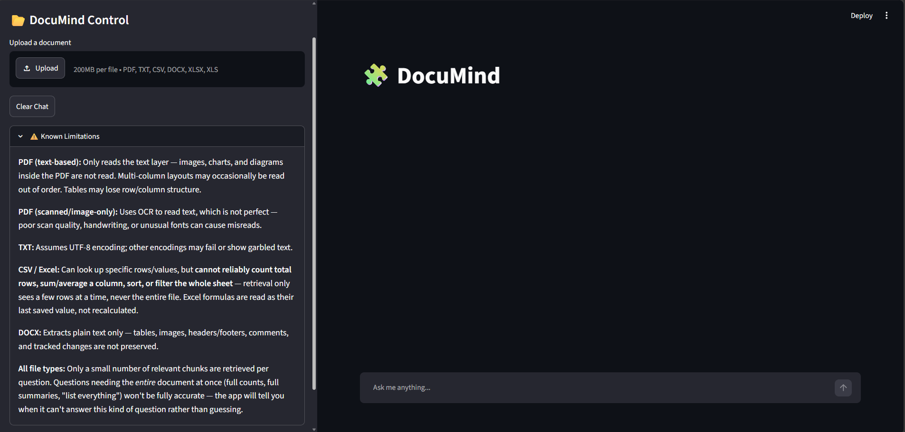

<!-- 📷 IMAGE PLACEHOLDER — commented out so it won't show broken until a real
     file exists here.
📍 Top of README
🖼️ Wide banner (1280x400px), DocuMind name over a simple document + chat-bubble illustration
💡 Suggested file: docs/images/banner.png
Uncomment once added:
<p align="center"></p>
-->

<h1 align="center">🧩 DocuMind</h1>
<p align="center"><b>Upload a document. Ask it questions in plain English. Get an answer — with proof of exactly where it came from.</b></p>

<p align="center">
  <a href="https://www.python.org/"></a>
  <a href="https://streamlit.io/"></a>
  <a href="https://python.langchain.com/"></a>
  <a href="https://www.trychroma.com/"></a>
  <a href="https://groq.com/"></a>
  <a href="LICENSE"></a>
</p>

<!-- ℹ️ Repo is private (shown to interviewers directly rather than linked
     publicly), so GitHub-hosted stats badges (stars/last-commit) can't
     resolve — they're intentionally left out rather than shown broken. -->


> 💡 **New here?** Jump to [What Should I Expect?](#-what-should-i-expect-when-using-this-app) — it explains the whole app like you've never used an AI tool before.

---

## 📚 Table of Contents

1. [What Is This?](#-what-is-this)
2. [The Problem It Solves](#-the-problem-it-solves)
3. [Features](#-features)
4. [Demo](#-demo)
5. [Architecture](#️-architecture)
6. [Tech Stack](#-tech-stack)
7. [Project Structure](#️-project-structure)
8. [How It Works — Complete Flow](#-how-it-works--the-complete-flow)
9. [Installation](#️-installation)
10. [Configuration](#-configuration)
11. [Testing With Sample Files](#-testing-with-sample-files)
12. [Evaluation & Accuracy](#-evaluation--accuracy)
13. [**Real-World Scenarios (Read This)**](#-real-world-scenarios)
14. [Memory: What's Remembered](#-memory-whats-remembered-and-for-how-long)
15. [Capability Matrix](#-capability-matrix)
16. [What This App CAN / CANNOT Do](#-what-this-application-can-do)
17. [Edge Cases](#️-edge-cases)
18. [What Should I Expect?](#-what-should-i-expect-when-using-this-app)
19. [Security](#-security)
20. [Performance](#-performance)
21. [Error Handling](#-error-handling)
22. [Future Improvements](#-future-improvements)
23. [Roadmap](#️-roadmap)
24. [Contributing](#-contributing)
25. [License](#-license)
26. [FAQ](#-faq)
27. [Author](#-author)
28. [Acknowledgements](#-acknowledgements)

---

## 📖 What Is This?

Imagine a super-smart friend who reads a book for you, then answers your questions about it — and always shows you the exact sentence they got the answer from, so you can check they're right.

**DocuMind is that friend, but it's a computer program.** You give it one document at a time (PDF, Word file, Excel sheet, CSV, or plain text), and then you chat with it about what's inside.


*DocuMind right after opening — sidebar with the upload control, Clear Chat, and the Known Limitations panel, before any document is loaded.*

## 🎯 The Problem It Solves

Reading a 40-page report to find one fact is slow, and a basic Ctrl+F only catches *exact words* — not "the same idea phrased differently." DocuMind understands **meaning**, not just text matches, so you can ask in your own words and still get the right answer, as long as it actually exists in the document.

**Who benefits:** students digging through research papers, professionals reviewing contracts/reports, or anyone who'd rather ask than read the whole thing.

---

## ✨ Features

- 📄 **Multi-format uploads** — PDF (text-based), TXT, CSV, DOCX, XLSX, XLS
- 🔍 **Hybrid search** — combines meaning-based (vector) search with exact keyword (BM25) search
- 💬 **Conversational follow-ups** within a session — "what about the second one?" is understood correctly
- 📎 **Transparent sourcing** — every answer shows the exact chunks it came from
- 🙅 **Refuses to guess** when the answer isn't in the document, or when a question needs the whole file at once (totals/counts)
- 🧹 **Auto-cleanup** — uploaded files are deleted right after processing
- ⚠️ **Honest, built-in limitations panel** in the app itself

---

## 🎥 Demo

Upload a document, click Process & Index, then ask a question in plain English — DocuMind retrieves the relevant chunks and answers using only what's actually in your file.
 


---

## 🏗️ Architecture

DocuMind uses a modular RAG architecture with two main workflows:

- **📥 Indexing:** `User → Streamlit → Document Loader → Text Chunking → Embeddings → ChromaDB`
- **💬 Question Answering:** `Question → History-Aware Rewriter → Hybrid Retrieval (Vector + BM25) → Groq LLM → Answer + Sources`

The complete system architecture is shown below:



---

## 🧰 Tech Stack

| Category | Technology | Why it's used |
|---|---|---|
| Frontend | Streamlit | Chat-style web app, pure Python, no separate frontend needed |
| Orchestration | LangChain (LCEL + `langchain-classic`) | Chains question-rewriting → retrieval → answer generation |
| LLM | `openai/gpt-oss-120b` via Groq API | Fast inference; replaced `llama-3.3-70b-versatile`, which Groq is retiring Aug 16, 2026 |
| Embeddings | `sentence-transformers/all-MiniLM-L6-v2` | Turns text into meaning-vectors, runs locally — no document content leaves the server just to be embedded |
| Vector DB | ChromaDB | Stores and searches those vectors |
| Keyword search | `rank_bm25` | Catches exact terms/names/numbers meaning-search alone might miss |
| PDF reading | `pypdf` | Extracts text from text-based PDFs (scanned/image-only PDFs are not supported) |
| Other formats | `docx2txt`, `pandas`, `openpyxl` | Reads DOCX, CSV, Excel |
| Secrets | `python-dotenv` | Loads the Groq API key from `.env`, never hardcoded |
| Testing | `pytest` | Automated checks for the retriever and loader logic |
| Deployment | Hugging Face Spaces | Hosts the public live app |

> ℹ️ **No database, no login system, no user accounts.** Everything lives in your current browser session — see [Memory](#-memory-whats-remembered-and-for-how-long) below.

---

## 🗂️ Project Structure

```text
rag_engine/
│
├── app.py                       # ⭐ The live app — everything below happens here
├── document_loader.py           # ⭐ Reads any supported file type (text-based PDFs only)
├── hybrid_retriever.py          # ⭐ Vector + BM25 search, merged and de-duplicated
│
├── requirements.txt             # Python packages
├── .env                         # Your Groq API key (never committed)
│
├── asset/                       # App icon
├── chroma_db/                   # Auto-created — current document's vectors live here
├── temp_data/                   # Auto-created — holds an upload briefly, then deletes it
│
├── images/
│   ├── README.md                # What each image is and where it's used
│   └── ... (screenshots + diagram, see images/README.md)
│
├── tests/
│   ├── README.md                # What's tested and how to run it
│   ├── test_hybrid_retriever.py
│   └── test_document_loader.py
│
├── sample_files/                # 🧪 Ready-to-use test files — one per supported format
│   ├── test_document.txt
│   ├── test_document.csv
│   ├── test_document.xlsx
│   ├── test_document.docx
│   └── test_document.pdf
│
└── experiments/                 # 🧪 Earlier prototypes, NOT used by the live app — kept as build history
    ├── app_backend.py           # Alternate FastAPI backend (upload/ask endpoints)
    ├── chat.py                  # Simplest RAG chain, using a local Ollama model
    ├── chunking.py
    ├── hybrid_search.py
    ├── ingest.py
    ├── loader.py
    ├── query.py
    └── store.py
```

**How the files interact:** `app.py` is the only file that runs directly. It imports `document_loader.py` to read whatever you upload, and `hybrid_retriever.py` to search through it. Nothing in `experiments/` is called by the running app.

---

## 🔄 How It Works — The Complete Flow

```
User opens the app
       ↓
User uploads a document (PDF / TXT / CSV / DOCX / XLSX / XLS)
       ↓
User clicks "🚀 Process & Index"
       ↓
Any previous document's data is deleted from the vector store
       ↓
Text is extracted from the document (PDFs must have a real text layer — scanned/image-only PDFs are rejected with a clear error)
       ↓
Text is split into ~800-character overlapping chunks
       ↓
Chunks are turned into vectors (meaning-fingerprints) and stored in ChromaDB
       ↓
The temporary uploaded file is deleted from disk
       ↓
User types a question
       ↓
If it's a follow-up, the app rewrites it into a standalone question using chat history
       ↓
The hybrid retriever searches the CURRENT document's vectors (meaning + keyword combined)
       ↓
Retrieved chunks + question are sent to the AI model (Groq)
       ↓
The model writes an answer USING ONLY the retrieved chunks
       ↓
Answer is shown, with an expandable list of the exact chunks used
```

---

## ⚙️ Installation

1. Install Python 3.10+: `python --version`
2. Clone the repo: `git clone https://github.com/Subham093/Documind_Engine.git && cd Documind_Engine`
3. Create a virtual environment: `python -m venv venv`
4. Activate it — Windows: `venv\Scripts\Activate.ps1` · Mac/Linux: `source venv/bin/activate`
5. Install packages: `pip install -r requirements.txt`
6. Get a free Groq API key at [console.groq.com](https://console.groq.com)
7. Create a `.env` file (see Configuration below)
8. Run it: `streamlit run app.py` → open `http://localhost:8501`

## 🔐 Configuration

```env
GROQ_API_KEY=your_groq_api_key_here
```

An environment variable is like a sticky note kept *outside* your code, so your secret key never ends up visible on GitHub. `.env` is already listed in `.gitignore` — double-check it stays that way before pushing.


---

## 🧪 Testing With Sample Files

Want to verify DocuMind actually works correctly, right after installing it? The `sample_files/` folder has one ready-made test file per supported format — upload any of them and ask the matching question below. If the answer comes back correct with sources shown, that format is confirmed working.

| File | Ask this | Correct answer should include |
|---|---|---|
| `test_document.txt` | "Who founded the company and when?" | Priya Sharma, 2019 |
| `test_document.csv` | "What is Meera Kapoor's salary and department?" | $110,000, HR |
| `test_document.xlsx` | "How many units of Battery Pack Pro were sold?" | 2,100 |
| `test_document.docx` | "How much grant funding did the project receive?" | 2.3 million AUD |
| `test_document.pdf` | "What is Project Greenline's budget?" | $18.5 million |

**Bonus test — honesty check:** each file has one deliberate "trap" fact it does *not* contain. Try asking about something unrelated (e.g. for `test_document.txt`, ask *"What does this say about semiconductor chips?"*) — a correct response says it can't find that information, rather than guessing.

---

## 📊 Evaluation & Accuracy

DocuMind was manually tested using the ready-made files in `sample_files/` — one per supported format, each containing known facts.

**Result: 6/6 correct.** Every question returned the accurate answer with sources shown, and both "trap" questions (asking about facts deliberately absent from the document) were correctly declined rather than guessed at — confirming the app's grounding behavior works as designed, not just in theory.

This isn't a large-scale benchmark — it's a small, honest, manually-verified check across every supported file type. See [Testing With Sample Files](#-testing-with-sample-files) above to reproduce it yourself.

---

## 🧭 Real-World Scenarios 

DocuMind is designed to support different real-world document interaction scenarios, from uploading and indexing a document to asking multiple questions and switching between documents.

Before exploring these scenarios, here's what the typical document-processing flow looks like:

A user begins by uploading a `.pdf` document and clicking **🚀 Process & Index**. DocuMind then starts reading and processing the uploaded document. While this is happening, the application displays a loading state to let the user know that the document is being processed.



Once the document has been successfully processed and indexed, DocuMind displays a confirmation message indicating that the document is ready to be queried.


### Scenario 1 — Upload One Document, Ask a Question


The app extracts its text, splits it into chunks, and stores those chunks as vectors. You ask *"What is the main objective of this paper?"* — the app searches only this document's chunks, retrieves the relevant ones, and the AI writes an answer using only that text, shown alongside its sources.


*A real question, answered — with the exact source chunks shown underneath so you can verify it yourself.*


### Scenario 2 — Ask Multiple Questions About the Same Document


✅ **Fully supported.** Ask as many questions as you like without re-uploading. Follow-ups like "and the second one?" work correctly, because the app rewrites them into standalone questions first.


*The user asks multiple questions about the same document in a single conversation, including a follow-up question that depends on the previous context.*


### Scenario 3 — Upload a Second Document


❌ **The second document REPLACES the first — it does not add to it.** Clicking Process & Index on `document2.pdf` first wipes `document1.pdf`'s stored vectors, then indexes the new file fresh:

```python
if st.session_state.vector_store is not None:
    st.session_state.vector_store.delete_collection()   # old document's index is wiped
    st.session_state.vector_store = None
# ...then a fresh index is built from only the new document
```

There's no "combined knowledge base" — only one document is searchable at a time.


*The user uploads and processes a second document. The newly indexed document replaces the previously indexed document, so only the latest document is available for retrieval.*


### Scenario 4 — Ask About the First Document After Uploading a Second


⚠️ **This is the part worth knowing carefully.** Two things happen at once:
- `document1.pdf`'s vector data is **gone** (deleted in Scenario 3)
- But your **chat history is not cleared** on a new upload — only clicking "Clear Chat" clears it

So a question about `document1.pdf` gets rewritten using chat history that still mentions it, but the retriever can only search `document2.pdf`'s vectors — the only ones that exist. The model should correctly respond *"I cannot find this information in the uploaded document."*

> ⚠️ **Known limitation:** once a new document is uploaded, the previous one's content is permanently gone from the searchable index, even though the chat history still mentions it. **To ask about a previous document again, re-upload it** — which will, in turn, replace whatever's currently loaded. Clicking **Clear Chat** before switching documents avoids any confusing carryover.


*After switching documents, a question about information from the previous document cannot be answered because its vectors have been removed from the searchable index.*


### Scenario 5 — Refresh / Close and Reopen the App


Refreshing starts a brand-new session. The vector store resets — the app does **not** automatically reconnect to the `chroma_db/` folder from before. You'll need to re-upload to continue. (Old vector data may still physically sit in `chroma_db/` on disk, but the running app never loads it back in automatically.)

---


## 🧠 Memory: What's Remembered, and For How Long

| Type of Memory | Supported? | Explanation |
|---|---|---|
| Remember current document while using it | ✅ | Yes, until a new upload or a page refresh |
| Ask multiple questions about the same document | ✅ | Fully supported |
| Remember chat history (conversation memory) | ✅ | Persists within a session, even across document uploads (see Scenario 4) |
| Upload multiple documents / combine them | ❌ | One document replaces the next |
| Search across multiple documents | ❌ | Not implemented |
| Ask about an older, already-replaced document | ❌ | Its data is deleted on new upload |
| Remember documents after refreshing the page | ❌ | Session resets, must re-upload |
| Remember documents after closing/reopening the app | ❌ | Same as above |
| Multiple users, properly isolated | ❌ | No login system; concurrent users share the same server-side `chroma_db`/`temp_data` folders |

---

## 🚦 Capability Matrix

| User Action | Supported? | Actual Behavior |
|---|---|---|
| Upload one document | ✅ | PDF (text-based), TXT, CSV, DOCX, XLSX, XLS |
| Ask multiple questions about it | ✅ | Chat history kept for the session |
| Read scanned/image-only PDFs | ❌ | Not supported — only PDFs with a real text layer can be read |
| Upload multiple documents at once | ❌ | Each new upload deletes the previous one |
| Search across multiple documents | ❌ | Not implemented |
| Return to a previously uploaded document | ❌ | Its data is gone once replaced |
| Remember chat history within a session | ✅ | Until "Clear Chat" or a refresh |
| Persistent storage across sessions | ❌ | Refresh/reopen requires re-uploading |
| Multiple users, properly isolated | ❌ | Not designed for concurrent multi-user use |

---

## ✅ What This Application CAN Do

- Accept **one document at a time** — PDF (text-based), TXT, CSV, DOCX, XLSX, or XLS
- Answer questions using **hybrid search** (meaning-based + keyword-based)
- Handle **follow-up questions** naturally within a session
- Show the **exact source chunks** behind every answer
- Say **"I don't know"** honestly when the answer isn't present
- Refuse to guess on **counting/totaling questions**, since it never sees the whole file at once
- **Auto-clean** temporary uploaded files after processing

## ❌ What This Application CANNOT Do

- Hold **more than one document** in memory at a time
- Answer questions about a **previously uploaded document** once replaced
- **Combine or search across** multiple documents
- **Remember anything after a refresh** or app restart
- Guarantee it will **never make a mistake** — hallucination risk is reduced, not eliminated
- Reliably answer **"how many/total/sum/list everything"** style questions
- **Isolate multiple simultaneous users** from each other
- **Read scanned or image-only PDFs** — DocuMind only reads PDFs with a real, selectable text layer; a scanned document or a photo of a document will be rejected with a clear error
- Preserve **tables, images, or formatting** from DOCX/PDF files


*This isn't a hidden footnote — the app discloses these exact limitations to the user, directly in the sidebar, before they ever hit one.*

---

## ⚠️ Edge Cases

| Situation | What Happens |
|---|---|
| Question asked with no document uploaded | Warning shown: *"Please upload a file first."* |
| Empty or blank PDF | Rejected with a clear error — no readable text found |
| Corrupted PDF | Loading fails gracefully — a processing error message, not a crash |
| Password-protected PDF | Fails to extract text, falls through to the "could not extract readable text" error |
| Scanned/image-only PDF | Detected automatically (no extractable text layer) and rejected with a clear "not supported" error |
| PDF with tables | Table structure isn't preserved — becomes plain flowing text |
| Very large file | Takes longer to process; no explicit file-size limit enforced in code |
| Same file uploaded twice | Treated as a fresh upload — replaces whatever was previously indexed |
| Unrelated question | Model is instructed to say it can't find the answer, not guess |
| Groq API failure | Caught and shown as an error message, not a silent crash |

---

## 💡 What Should I Expect When Using This App?

- **Upload:** one file at a time — PDF (text-based), TXT, CSV, DOCX, XLSX, or XLS
- **Wait time:** a few seconds to under a minute, depending on document length
- **Answers:** short (up to 3 sentences for normal questions), always tied to a visible source you can double-check
- **New upload = fresh start**, not "adding to what's there"
- **Unsupported questions** (e.g. "how many total rows?") get an honest "can't answer that from what I have" instead of a guess
- **Invalid/unreadable PDFs** show a clear on-screen error, never a silent failure

---

## 🔒 Security

- API key loaded via `.env`, never hardcoded
- `.env`, `venv/`, and `chroma_db/` excluded from Git via `.gitignore`
- Temp files deleted immediately after processing
- No login system — single-user tool by design, not a multi-tenant platform

---

## ⚡ Performance

- Chunk size ~800 characters, 80-character overlap
- BM25 keyword index is rebuilt on every question — fine at single-document scale, would need caching at larger scale
- One-document-at-a-time design keeps search fast, at the cost of no multi-document support

---

## 🧯 Error Handling

- Unsupported file type → clear error naming the supported types
- Unreadable or scanned/image-only PDF → clear error explaining it may be unsupported, corrupted, or password-protected
- Temp file cleanup failures (e.g. Windows file locks) → caught, non-fatal
- General processing errors → shown as friendly messages, never raw crashes

---

## 🚀 Future Improvements

- [ ] Support multiple documents at once, with real cross-document search
- [ ] Auto-reconnect to a previous session's document after refresh
- [ ] Add basic user login/isolation for multi-user use
- [ ] Cache the BM25 index instead of rebuilding it per question
- [ ] Preserve tables from PDFs/DOCX properly
- [ ] Bring the FastAPI backend prototype up to parity and deploy as a real API

---

## 🗺️ Roadmap

**Near-term**
- [ ] Add automated tests for edge cases (corrupted files, empty uploads)
- [ ] Cache the BM25 index instead of rebuilding it per question

**Mid-term**
- [ ] Support multiple documents at once, with real cross-document search
- [ ] Preserve tables from PDFs/DOCX properly
- [ ] Basic user login/isolation for multi-user use

**Long-term**
- [ ] Bring the FastAPI backend up to parity and deploy as a real, documented API
- [ ] Persistent cross-session memory (remember documents after closing the app)

---

## 🤝 Contributing

Contributions, suggestions, and improvements are welcome!

To contribute:

1. Fork the repository.

2. Create a new feature branch:

```bash
   git checkout -b feature/your-feature
```

3. Make your changes and add or update tests where applicable.

4. Run `pytest tests/ -v`

5. Commit your changes and push the branch.

6. Open a Pull Request with a clear description of your changes.

---

## 📄 License

This project is licensed under the **[MIT License](LICENSE)**.

---

## ❓ FAQ

<details>
<summary><b>Can I upload more than one document at a time?</b></summary>
<br>

No — uploading a new document replaces the previous one entirely. See [Real-World Scenarios](#-real-world-scenarios) for exactly why.
</details>

<details>
<summary><b>Does it work with scanned PDFs or photos of documents?</b></summary>
<br>

No — only PDFs with a real, selectable text layer are supported.
</details>

<details>
<summary><b>Is my document data sent anywhere?</b></summary>
<br>

Only the retrieved text chunks and your question are sent to Groq's API to generate the answer. Embeddings are computed locally.
</details>

<details>
<summary><b>Why does it sometimes say "I cannot find this information"?</b></summary>
<br>

That's intentional — the app is designed to admit when it doesn't know rather than guess.
</details>

<details>
<summary><b>Can it tell me exact counts, totals, or sums from a spreadsheet?</b></summary>
<br>

No — it only ever sees a handful of retrieved rows/chunks, never the entire file, so it won't reliably answer aggregate questions.
</details>

<details>
<summary><b>What happens if I refresh the page?</b></summary>
<br>

Everything resets — you'll need to re-upload your document.
</details>

---

## 👤 Author

**Subham Maheswari Jena**

*Email - subhammaheswarijena11339@gmail.com*

*Github - https://github.com/Subham093*

DocuMind was built as a hands-on Retrieval-Augmented Generation (RAG) project to explore document intelligence, semantic search, vector retrieval, and LLM-powered question answering.

I'm continuously improving the project and exploring practical applications of Generative AI, RAG systems, NLP, and AI-powered document processing.

---

## 🙏 Acknowledgements

This project was built with the help of the following open-source technologies and libraries:

- LangChain — LLM application and RAG orchestration
- Groq — LLM inference
- ChromaDB — Vector storage and retrieval
- Hugging Face — Embeddings and NLP models
- Streamlit — Interactive web application
- rank_bm25 — BM25-based keyword retrieval

A huge thanks to the open-source community and the developers maintaining these projects.

